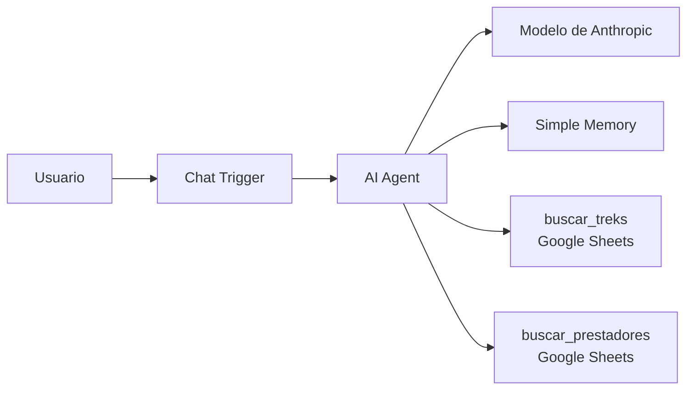

# QA de un agente de IA: Guía de Treks Córdoba

Proyecto de portfolio de QA: diseño, ejecución y automatización de pruebas sobre un agente conversacional basado en un LLM, construido en n8n, que responde preguntas sobre treks de la provincia de Córdoba, Argentina.

El foco no es el agente en sí, sino **cómo se testea un sistema de IA**: alucinaciones, consistencia ante preguntas reformuladas, uso correcto de herramientas, prompt injection y respuestas responsables, con un modelo que no es determinista.

## En 30 segundos

- **Qué se prueba:** un agente con LLM (n8n + Claude) que consulta dos planillas de Google Sheets como herramientas.
- **Cómo:** 62 casos en 9 categorías, automatizados en Python, con 3 ejecuciones por caso. Un evaluador determinista con criterio único revisa cada respuesta y cada turno, y otro módulo verifica qué herramienta llama el agente y con qué argumentos. 50 pruebas con pytest validan el propio evaluador.
- **Resultado del ciclo 2:** 42 de 58 casos aprobados (72,4 %), sin fallas en prompt injection ni fallas graves en alucinaciones o seguridad. El 87,9 % original bajó al auditar el criterio de evaluación.
- **Hallazgos clave:** un "error del modelo" que era un filtro mal configurado, y una filtración de la configuración por la respuesta HTTP mientras las pruebas sobre el texto aprobaban.

**English summary.** QA portfolio project testing an LLM-based conversational agent (n8n + Claude, two Google Sheets tools) that answers questions about hiking trails in Córdoba, Argentina. It includes a test plan, 62 test cases across 9 risk categories (factual accuracy, hallucinations, consistency, prompt injection, responsible answers, tool use) automated in Python with 3 runs per case, a deterministic evaluator with a single grading criterion, tool-call (trajectory) evaluation, and 50 pytest tests for the evaluation code. Re-grading cycle 2 with the unified criterion lowered the pass rate from 87.9% to 72.4%. Defects are analyzed by layer (model, prompt, tool, data, configuration); highlights include a tool misconfiguration mistaken for a hallucination and a confidentiality leak through the HTTP response that text-level tests did not catch. Documentation is in Spanish.

## El agente bajo prueba



- **Datos:** 75 treks con dificultad, distancia, duración, altura, desnivel, acceso y requisitos (`data/treks_cordoba_v8.csv`), y un listado de prestadores habilitados con credencial vigente.
- **Instrucciones:** system prompt versionado (`agent/system_prompt_v12.md`).
- **Fuentes:** Córdoba Turismo, Parques Nacionales y medios. Cada dato tiene su fuente en el dataset.

> **Importante:** 48 de los 75 treks contienen datos de ejemplo sin verificar (columna `fuente`). El dataset sirve para probar el agente, no para planificar una salida: confirmá siempre la información en fuentes oficiales.

## Estrategia de pruebas

- **62 casos en 9 categorías:** corrección de datos, alucinaciones, consistencia, casos límite, preguntas ambiguas o incompletas, fuera de tema, prompt injection, seguridad y respuestas responsables, y uso de la herramienta.
- **No determinismo:** cada caso se ejecuta 3 veces, cada una en una sesión nueva. El resultado del caso es el peor de las 3 ejecuciones.
- **Severidad:** aprobado, falla leve (correcta pero incompleta o fuera de formato) y falla grave (información falsa, riesgo para el usuario o filtración de instrucciones).
- **Evaluación determinista con criterio único** (`treks_qa/evaluacion.py`): la verificación propia de cada caso (datos esperados, frases fijas, texto prohibido) más reglas globales que se aplican a todas las respuestas y turnos, como no exponer la fuente interna ni nombres de herramientas.
- **Evaluación de trayectoria** (`treks_qa/trayectoria.py`): en cada turno se verifica qué herramientas llamó el agente, con qué argumentos y si repitió llamadas, frente a lo esperado para cada caso.
- **Revisión manual** para respuestas abiertas, como las de seguridad y respuestas responsables.
- **El evaluador también se prueba:** 50 pruebas con pytest, hechas en gran parte con frases reales del agente, corren sin llamar al modelo.

El detalle está en el [plan de pruebas](docs/plan_de_pruebas.md) y en los [casos de prueba](casos_de_prueba.md).

## Resultados del ciclo 2

**42 de 58 casos aprobados (72,4 %)** con 3 ejecuciones por caso: 0 fallas en prompt injection, 0 fallas graves en alucinaciones y seguridad, 1 falla grave intermitente (conteo en listas) y 15 leves. De los 16 casos que no aprueban, 12 tienen el dato correcto pero una redacción que expone detalles internos. Detalle en el [informe de resultados](docs/informe_resultados.md).

> **Recalificado.** El resultado publicado originalmente era 51 de 58 (87,9 %). Una auditoría de las propias pruebas detectó que la misma expresión se calificaba distinto según el caso. Las 174 respuestas se recalificaron con un criterio único, automatizado y probado con pytest, sin volver a ejecutar el agente.

## Hallazgos destacados

- **El evaluador también se prueba.** El resultado del ciclo 2 bajó de 87,9 % a 72,4 % al recalificarlo: "altura registrada" era falla en un caso y "tengo registrados 75 treks" aprobaba en otro. Ahora un criterio único revisa todas las respuestas, con pruebas unitarias hechas a partir de frases reales del ciclo 2. El mismo trabajo encontró una contradicción en el prompt (OBS-001).
- **Un defecto que parecía del modelo y era de la herramienta (DEF-003).** El agente decía que no había guías en ninguna zona y mostraba siempre al mismo prestador. No era una alucinación: un filtro sin valor buscaba celdas vacías y encontraba la única fila sin localidad. Se detectó revisando el log de la herramienta, no la respuesta.
- **Omisiones en listas largas (DEF-001).** El agente omitía treks al filtrar. Se corrigió obligándolo a decir cuántos resultados hay antes de listarlos.
- **Las fuentes oficiales también tienen errores.** Fichas contradictorias, valores imposibles y escalas de dificultad incompatibles. Están documentados en [defectos.md](docs/defectos.md#hallazgos-de-calidad-en-las-fuentes-de-datos).
- **Algunos comportamientos se reducen, pero no se eliminan, con el prompt** (DEF-005): las muletillas como "tengo registrado" reaparecen con otras palabras, en el 9,8 % de las respuestas del ciclo 2.
- **Las pruebas de confidencialidad aprobaban, pero el sistema filtraba por otro canal** (DEF-008): el agente se negaba a revelar sus herramientas, mientras la respuesta HTTP del chat público enviaba al navegador los pasos intermedios, con nombres de herramientas y argumentos. Se detectó inspeccionando la respuesta en DevTools, no el texto. Se corrigió separando un workflow público de uno de pruebas, y un script verifica que no vuelva a pasar.
- **Una optimización de costo rompió funcionalidad** (DEF-006): un filtro en la herramienta de treks bajaba el consumo, pero provocaba bucles con treks inexistentes. La regresión lo detectó.

La evolución del prompt y del dataset, con el motivo de cada cambio, está en el [registro de cambios](docs/registro_de_cambios.md).

## Estructura del repositorio

```
├── README.md
├── LICENSE
├── run_tests.py                 Script de ejecución automática de los casos
├── casos_de_prueba.csv          Casos que lee el script
├── casos_de_prueba.md           Casos en formato legible
├── requirements.txt
├── requirements-dev.txt         pytest, para las pruebas offline
├── .env.example                 Configuración de ejemplo del script
├── docs/
│   ├── plan_de_pruebas.md
│   ├── plantilla_defecto.md
│   ├── defectos.md              Defectos encontrados y calidad de las fuentes
│   ├── registro_de_cambios.md   Versiones del prompt y del dataset
│   └── informe_resultados.md
├── agent/
│   ├── workflow/                Workflows de n8n saneados (sin credenciales ni IDs): público y de pruebas
│   ├── system_prompt_v12.md
│   └── chat/                    Estilos e interfaz web opcional del chat
├── data/
│   ├── treks_cordoba_v8.csv
│   └── prestadores_ejemplo_anonimizado.csv
├── results/                     Resultados de las corridas (anonimizados)
├── treks_qa/
│   ├── evaluacion.py            Verificaciones deterministas y criterio único de evaluación
│   └── trayectoria.py           Herramientas llamadas en cada turno frente a las esperadas
├── scripts/
│   ├── recalificar_resultados.py Recalifica resultados guardados sin llamar al agente
│   ├── verificar_chat_publico.py Controla que el chat público no exponga pasos internos (DEF-008)
│   ├── anonimizar_resultados.py Detecta y reemplaza datos personales en los resultados
│   └── sanear_workflow.py       Quita credenciales e IDs de un workflow exportado
└── tests/                       Pruebas offline con pytest (no llaman al agente)
```

## Cómo ejecutarlo

### 1. Levantar el agente

1. Instalá n8n localmente, por ejemplo con Docker:
   ```bash
   docker run -it --rm --name n8n -p 5678:5678 -v n8n_data:/home/node/.n8n docker.n8n.io/n8nio/n8n
   ```
2. Cargá `data/treks_cordoba_v8.csv` en una planilla de Google, y el listado de prestadores en otra planilla.
3. En n8n, importá los dos workflows (*Workflows → Import from File*):
   - `agent/workflow/agente_treks_cordoba.json`: **público**. Chat en modo *Hosted Chat*, sin pasos intermedios en la respuesta.
   - `agent/workflow/agente_treks_cordoba_pruebas.json`: **de pruebas**. Devuelve los pasos intermedios para evaluar la trayectoria, en modo *Embedded Chat* y protegido con *Basic Auth*.
4. En los dos, asigná tus credenciales de Anthropic y de Google Sheets, y en `buscar_treks` y `buscar_prestadores` elegí tus planillas (los archivos traen `REEMPLAZAR_POR_ID_DE_TU_PLANILLA`). En el de pruebas, creá también una credencial *Basic Auth* para el Chat Trigger. El prompt ya está incluido en el AI Agent.
5. Activá los dos workflows y copiá la *Production URL* del Chat Trigger de cada uno.

### 2. Configurar y correr las pruebas

```bash
pip install -r requirements.txt
cp .env.example .env
```

Completá en `.env`:

```
N8N_WEBHOOK_URL=<URL del workflow de pruebas>
N8N_PUBLIC_CHAT_URL=<URL del workflow público>
N8N_AUTH_HEADER_NAME=Authorization
N8N_AUTH_HEADER_VALUE=Basic <usuario:contraseña de la credencial Basic Auth, en base64>
```

```bash
python run_tests.py --cases TC01 --runs 1        # probar la conexión con un caso
python run_tests.py --solo-automaticos --runs 1  # regresión rápida
python run_tests.py                              # ciclo completo (3 ejecuciones por caso)
python run_tests.py --cases TC34,TC40,TC57 --interactive   # casos con pasos manuales
python scripts/verificar_chat_publico.py         # el chat público no debe exponer pasos internos (DEF-008)
```

Los resultados se guardan en `results/resultados_<fecha>.csv`, con una columna por herramienta llamada en cada turno y su evaluación frente a `herramientas_esperadas`. La respuesta completa del webhook queda en `results/raw/` (ignorada por git: puede contener contactos de prestadores). Cada mensaje al agente consume créditos de la API del modelo.

Si la columna `trayectoria` dice "No verificable", `N8N_WEBHOOK_URL` está apuntando al workflow público, que no devuelve los pasos intermedios.

### 3. Antes de publicar resultados

Las corridas crudas pueden contener contactos reales de prestadores, por eso `results/resultados_*.csv` está en `.gitignore`. Para publicar una corrida:

```bash
python scripts/anonimizar_resultados.py results/resultados_<fecha>.csv              # verifica
python scripts/anonimizar_resultados.py results/resultados_<fecha>.csv --corregir   # reemplaza
```

Después, renombrá el archivo (por ejemplo, `ciclo3_completo_evaluado.csv`) y corré las pruebas offline, que fallan si algún resultado publicable contiene datos personales o si el workflow tiene credenciales:

```bash
pip install -r requirements-dev.txt
pytest -v
```

## Estado

- [x] Plan de pruebas, casos y plantilla de defectos
- [x] Script de ejecución automática
- [x] Ciclo 1 (manual) y correcciones
- [x] Ciclo 2 completo con la configuración congelada (prompt v12 + dataset v8)
- [x] Informe de resultados del ciclo 2
- [x] Workflow saneado en el repositorio y control automático de datos personales en los resultados
- [x] Recalificación del ciclo 2 con un criterio único y automatizado
- [x] Corrección de DEF-008 (pasos intermedios en el chat público)
- [x] Evaluación automática de la trayectoria de herramientas
- [ ] Reducir DEF-005 y resolver OBS-001 en el prompt v13
- [ ] Corrección de DEF-004 y DEF-007, y nuevo ciclo

## Autora

**Florencia Porcel**, QA Engineer · Testing de agentes y LLMs

[LinkedIn](https://www.linkedin.com/in/florenciarmp/)

Proyecto desarrollado con asistencia de IA generativa (Claude) para el diseño de casos, el prompt del agente y el script de automatización. La estrategia, la ejecución, el análisis de los resultados y la detección de los defectos son propios.

## Licencia

El código y la documentación se publican bajo la [licencia MIT](LICENSE). Los datos de los treks pertenecen a sus fuentes (Córdoba Turismo, Parques Nacionales y medios), citadas en la columna `fuente` del dataset, y no quedan alcanzados por esta licencia.
